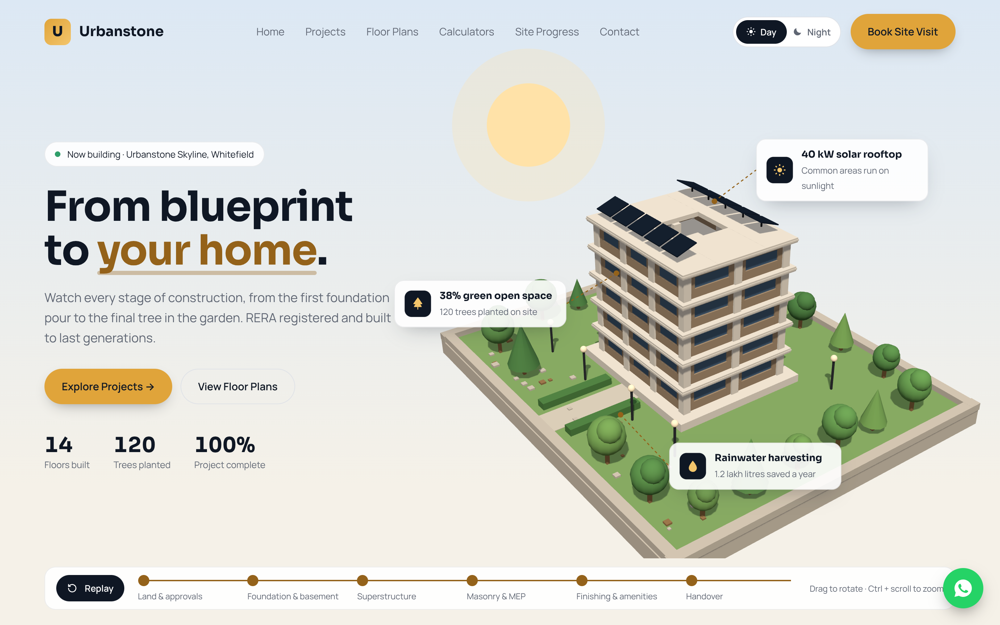

# Urbanstone Builders: 3D construction showcase

A front-end website for a builder of apartments and houses, made with **React + Vite + Three.js**. The home page plays an animated 3D construction, from an empty plot to the finished building, with a Day/Night theme.



## Features
- **Animated 3D hero.** The building rises stage by stage while trees grow. Insight cards are pinned to the model, with live counters and a stage bar.
- **Day / Night theme** for the whole site. It is saved in `localStorage` and follows the OS setting on first visit. The 3D lighting switches too: lit windows, LED strips, street lamps and fireflies at night.
- **Projects** with status/type filters, search, an empty state and a saved shortlist. The "Under construction" card shows a live 3D model.
- **Unit selector:** pick a tower and a flat to see live availability, a 2D floor plan, area, facing, price and EMI.
- **EMI calculator** and **house construction cost estimator.**
- **Construction tracker:** click a milestone or drag the time slider to move the 3D model to that stage.
- **Site-visit booking form** with validation and a WhatsApp follow-up link.
- **Responsive and accessible:** mobile menu, keyboard focus styles, ARIA labels, and a reduced-motion mode that skips the build animation.

## Run it

```bash
npm install
```

```bash
npm run dev
```

Then open the URL Vite prints (usually http://localhost:5173). Add `?theme=night` to the URL to open in night mode.

| Command | What it does |
|---|---|
| `npm run dev` | Start the dev server with hot reload |
| `npm run build` | Production build into `dist/` |
| `npm run preview` | Serve the production build locally |
| `npm test` | Run unit tests (Vitest) |

## Project structure

```
src/
├── main.jsx, App.jsx          entry point and page layout
├── styles/global.css          design tokens (colours for day + night), buttons, layout
├── context/ThemeContext.jsx   day/night state shared with every component
├── hooks/
│   ├── useBuildScene.js       mounts the 3D scene on a canvas, cleans up on unmount
│   └── useMediaQuery.js
├── three/buildScene.js        the Three.js construction scene (plain JS, no React)
├── lib/                       pure logic with unit tests: EMI, cost, price, filters, form validation
├── data/                      projects, units, milestones, insights (placeholder content)
└── components/                Navbar, Hero, Projects, UnitSelector, Calculators, Progress, Contact, Footer
mockups/                       the original HTML design mockups
docs/                          feature plan and preview images
scripts/check-app.cjs          browser smoke test + screenshots (Playwright)
```

## How the 3D works with React
- `three/buildScene.js` is plain Three.js. Its API is `setProgress`, `replay`, `jump`, `setTheme`, `onProgress`, `onFrame`, `project` and `dispose`.
- `useBuildScene` creates the scene inside `useEffect` and calls `dispose()` in the cleanup. That cleanup is essential: React StrictMode mounts components twice in development.
- **Progress** goes into React state (rounded), so counters and the stage bar re-render about 200 times per build, not 60 times a second.
- **Insight-card positions** change every frame, so `InsightLayer` updates the DOM directly through refs instead of React state.

## Notes
- Project names, prices, RERA number and insight figures are **placeholders**. Replace the files in `src/data/` with the client's real data.
- The site-visit form has no backend yet. `SiteVisitForm.jsx` marks where an API call would go.
