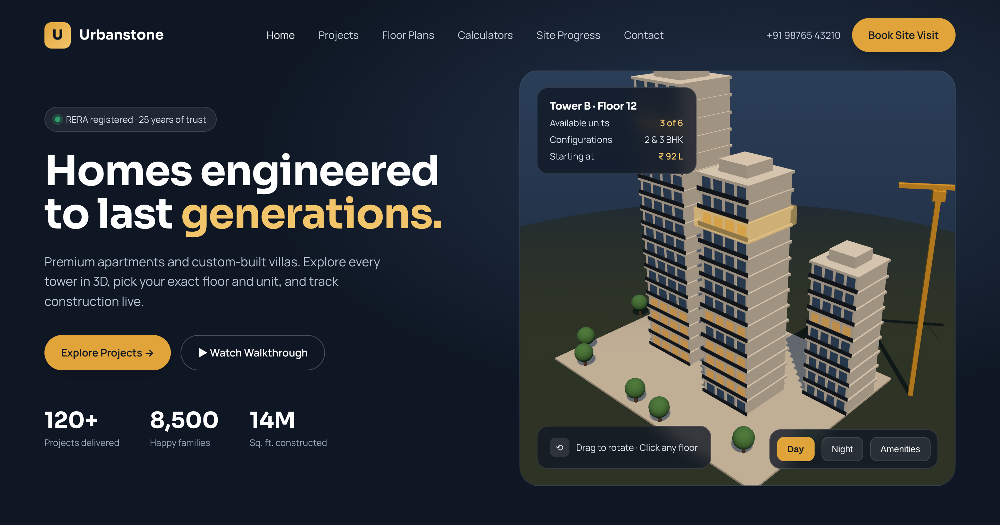
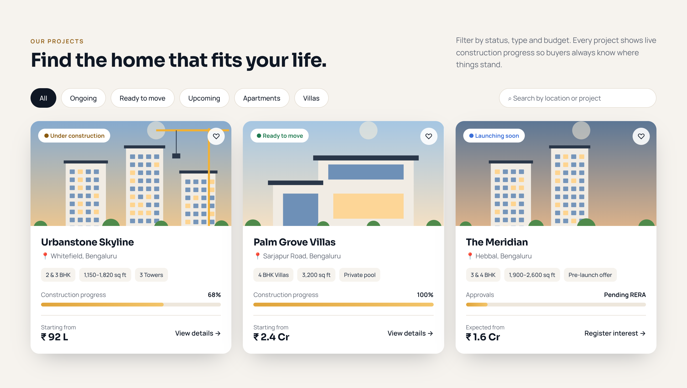
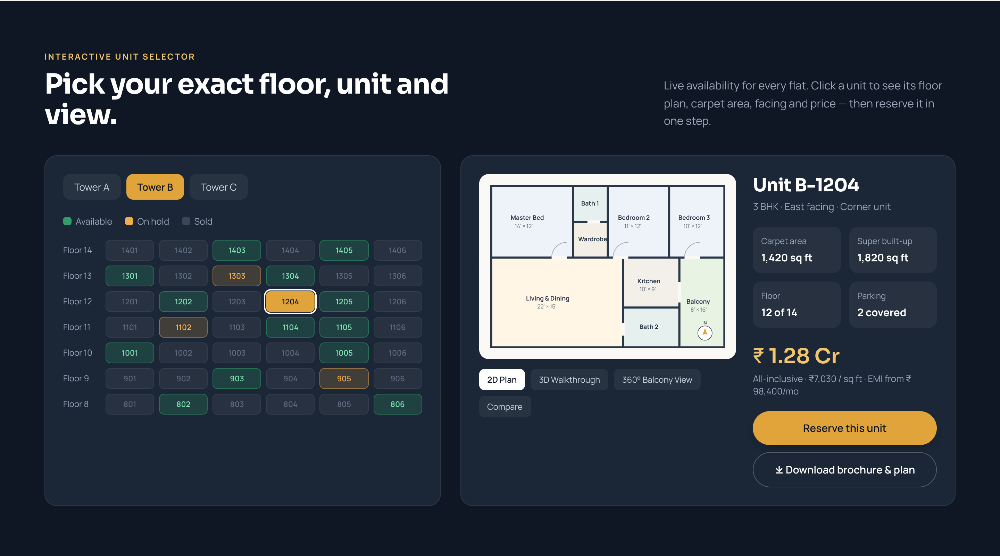
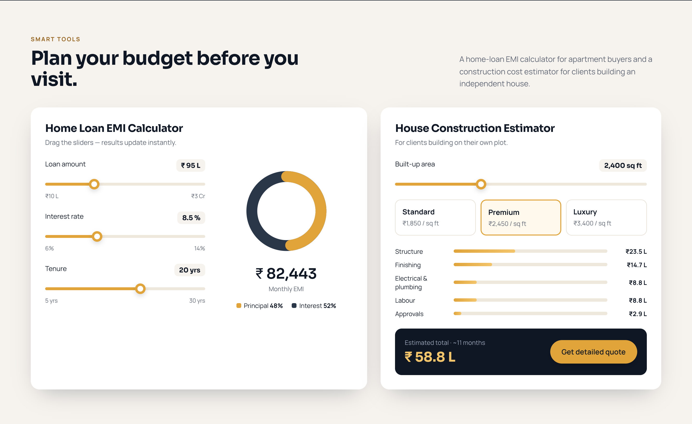
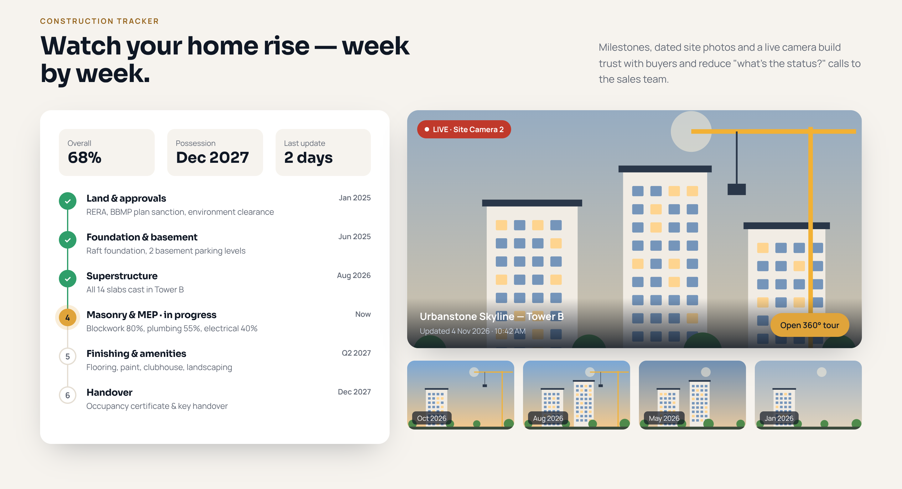
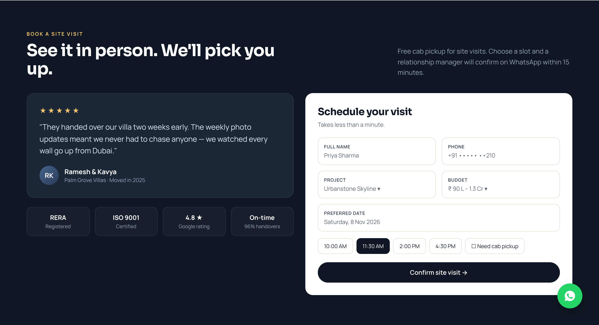
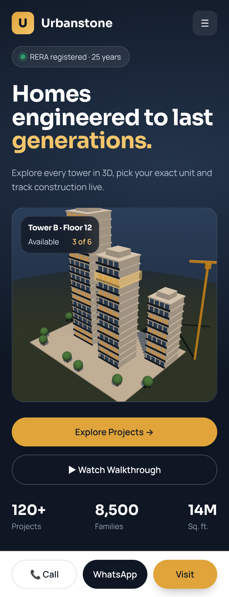

# Builder's Website: Feature Plan

This plan is for a front-end-only showcase website for a construction company that builds apartments and independent houses. All data can be stored in local JSON files. You don't need a backend for the client demo.

## Preview images

| # | Screen | Preview |
|---|--------|---------|
| 1 | Hero section with an interactive 3D tower (Three.js) |  |
| 2 | Projects showcase with filters and progress bars |  |
| 3 | Interactive unit selector and floor plan |  |
| 4 | EMI calculator and house construction cost estimator |  |
| 5 | Construction progress tracker |  |
| 6 | Testimonials and site-visit booking |  |
| 7 | Mobile view |  |

To try the working mockup (you can drag the 3D model, click a floor, and move the EMI sliders):

```bash
python3 -m http.server 8080 --directory mockups
```

Then open http://localhost:8080.

---

## Key features (by priority)

### Must-have (these get you the client)
1. **3D hero model (Three.js).** A rotating apartment complex. Clicking a floor shows how many units are available on it and the starting price. This is the "wow" moment.
2. **Projects showcase.** Filter by Ongoing, Ready to move, Upcoming, Apartments or Villas, and search by location. Each card shows a status badge, configuration (BHK), area, starting price and a construction progress bar.
3. **Project detail page.** Image gallery, amenities, location map (Google Maps embed), RERA number, specifications and a brochure download.
4. **Interactive unit selector.** Pick a tower, then a floor, then a unit, with each unit colour-coded as available, on hold or sold. Selecting a unit shows its 2D floor plan, carpet and super built-up area, facing direction and price.
5. **Site-visit booking and lead form.** Date and time-slot picker, a cab-pickup option, a floating WhatsApp button, and a click-to-call button on mobile.
6. **Fully responsive design** with a sticky Call / WhatsApp / Visit bar on mobile.

### Should-have (shows you think like a product engineer)
7. **Home loan EMI calculator.** Live sliders and a donut chart showing the principal/interest split.
8. **House construction cost estimator.** Built-up area combined with a quality tier (Standard, Premium or Luxury) gives a cost breakdown.
9. **Construction progress tracker.** A milestone timeline, dated site photos and a "live camera" or 360° tour card.
10. **Testimonials and trust badges.** RERA, ISO, Google rating and on-time delivery rate.
11. **Day/Night toggle in the 3D scene.** Optionally, add an amenities overlay too (pool, clubhouse, park).

### Nice-to-have (stretch goals)
12. **3D walkthrough or 360° balcony view** of a single apartment.
13. **Compare units side by side.**
14. **Shortlist/favourites** saved in `localStorage`.
15. **Customer portal mock:** payment schedule, documents and progress for "my unit".
16. **Multi-language support** (English / regional language) and an optional dark mode.

---

## Suggested tech stack

| Need | Choice | Why |
|------|--------|-----|
| Framework | **React + Vite** | Fast dev server, simple setup |
| 3D | **Three.js via React Three Fiber + @react-three/drei** | Lets you write Three.js as React components (`OrbitControls`, `useGLTF`) |
| Routing | React Router | Pages: Home, Projects, Project Detail, Contact |
| Styling | Tailwind CSS or CSS Modules | Quick, consistent spacing and colours |
| Animation | Framer Motion | Scroll reveals and page transitions |
| State | Context API (shortlist, selected unit) | Redux is overkill for this size |
| Charts | Recharts or a hand-made SVG donut | For the EMI chart |
| Forms | React Hook Form | Validation without re-render overhead |
| Data | `src/data/projects.json` | Mock API, so a real backend can be swapped in later |
| Hosting | Vercel or Netlify (free) | Share a live link with the client |

## Suggested folder structure

```
src/
  components/   Navbar, Footer, ProjectCard, UnitGrid, FloorPlan, EmiCalculator, ...
  three/        TowerScene.jsx, Building.jsx, Floor.jsx
  pages/        Home, Projects, ProjectDetail, Contact
  data/         projects.json, units.json, testimonials.json
  context/      ShortlistContext.jsx
  hooks/        useEmi.js, useUnits.js
```

## Build order (about 3 weeks)
1. **Week 1:** Vite setup, layout, navbar, hero (static first), projects grid with filters, responsive design.
2. **Week 2:** 3D tower in React Three Fiber, project detail page, unit selector and floor plan.
3. **Week 3:** Calculators, progress tracker, booking form, performance pass (lazy-load the 3D scene, compress images), deploy.

## Performance tips for the 3D scene
- Lazy-load the canvas with `React.lazy` and show a poster image until it loads.
- Cap the pixel ratio: `dpr={[1, 2]}`.
- Use a low-poly GLB model (under 2 MB) compressed with Draco.
- Pause rendering when the scene is off-screen (`frameloop="demand"` or an IntersectionObserver).
- Provide a static image fallback on low-end phones.
